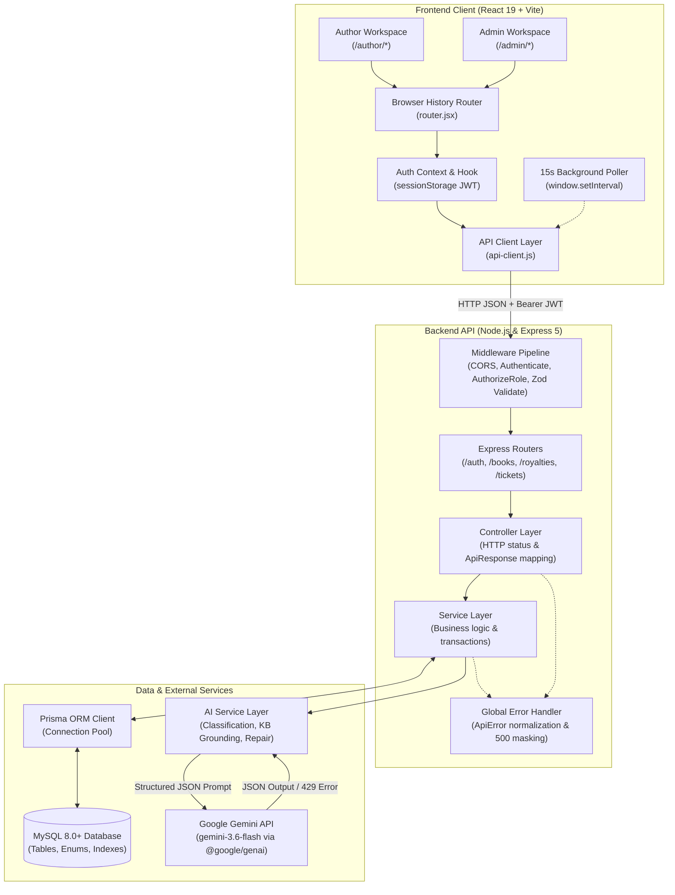

# System Architecture: BookLeaf AuthorDesk

This document outlines the architecture, component boundaries, and request flows of the BookLeaf AuthorDesk portal.

---

## 1. System Overview & Component Diagram

BookLeaf AuthorDesk is organized into a modular full-stack architecture comprising a React 19 Single Page Application (SPA), a layered Express 5 REST API, a relational MySQL persistence layer managed by Prisma ORM, and an external AI integration powered by the Google Gemini API.

---

## 2. Component Breakdown

### Frontend Layer (`client/`)
- **Runtime & Bundler:** React 19.3 with Vite 8.3.
- **Routing:** A lightweight browser-history router ([router.jsx](file:///home/raysec/Project/BookLeaf/BookLeaf%20AuthorDesk/client/src/app/router.jsx)) utilizing the HTML5 History API (`pushState`, `replaceState`, `popstate` events) with client-side role guards (`AUTHOR` vs `ADMIN`).
- **State Architecture:** State is scoped to component trees and custom hooks (`useAuth`, local page state). Avoids complex third-party global stores, reducing bundle footprint and eliminating state desynchronization.
- **Design System:** Native semantic CSS ([index.css](file:///home/raysec/Project/BookLeaf/BookLeaf%20AuthorDesk/client/src/index.css)) organized by feature, utilizing an indigo author theme and a coral administrative theme.
- **Real-Time Strategy:** 15-second background polling via `window.setInterval` on active ticket queue and details pages, keeping data fresh without persistent connection overhead.

### Backend Layer (`server/`)
- **Web Framework:** Express 5.3 with native async route handling.
- **Middleware Pipeline:**
  1. `cors`: Origin validation bound to `CLIENT_URL`.
  2. `express.json`: Body parsing with 1MB size limit.
  3. `authenticate`: JWT signature and expiry verification; attaches sanitized `req.user`.
  4. `authorizeRole`: Enforces role-based permissions (`ADMIN` vs `AUTHOR`).
  5. `validateRequest`: Zod schema validation intercepting invalid payloads before reaching controllers.
  6. `errorHandler`: Formats application errors (`ApiError`), preserves safe status codes and retry hints, while masking unexpected internal exceptions in production.
- **Service Layer Pattern:** Controllers focus exclusively on HTTP transport, status codes, and JSON serialization. Business logic, multi-model Prisma transactions, and AI orchestrations reside in dedicated services (`ticket.service.js`, `ai.service.js`, `response-generation.service.js`).

### Data Persistence Layer
- **Database:** MySQL 8.0+ enforcing foreign key constraints and transactional semantics.
- **ORM:** Prisma ORM 6.19 providing schema definitions, versioned SQL migrations, and automated TypeScript/JavaScript query client generation.
- **Key Schema Entities:** `User`, `Book`, `RoyaltyRecord`, `Ticket`, `TicketReply`, `TicketInternalNote`.
- **Indexing Strategy:**
  - `Ticket(status, priority, createdAt)` for admin queue filtering and ordering.
  - `TicketReply(ticketId, createdAt)` for chronological conversation rendering.
  - `TicketReply.aiDraftId` with unique constraint to prevent duplicate AI draft dispatch.

### AI Integration Layer
- **Client SDK:** `@google/genai` (v2.31.0) communicating with Google Gemini API (`gemini-3.6-flash`).
- **Grounded Knowledge Base:** In-memory policy repository ([knowledge-base.js](file:///home/raysec/Project/BookLeaf/BookLeaf%20AuthorDesk/server/src/modules/ai/knowledge-base.js)) providing official BookLeaf operational terms (80/20 profit split, quarterly payout cycle, ISBN rules, print turnarounds).
- **Resilience:** Exponential backoff retry logic for transient 503/network failures, early-exit detection for daily quota exhaustion, single-pass in-memory JSON repair, and safe error normalization ([ai-errors.js](file:///home/raysec/Project/BookLeaf/BookLeaf%20AuthorDesk/server/src/modules/ai/ai-errors.js)).

---

## 3. End-to-End Request Flows

### Flow A: Ticket Creation & Async AI Classification
1. **Client Submission:** Author submits ticket form at `/author/tickets/new`.
2. **Validation:** `validateRequest(createTicketSchema)` verifies subject (&ge; 5 chars), description (&ge; 10 chars), and optional `bookId`.
3. **AI Classification:** `classifyTicket()` invokes Gemini with subject and description. The model returns category, priority, and reasoning. If the AI call fails, classification is caught gracefully without blocking ticket creation.
4. **Database Insertion:** `prisma.ticket.create()` persists the ticket with suggested or default metadata.
5. **Response:** HTTP 201 returns sanitized ticket summary to the author.

### Flow B: Admin Triage & Grounded AI Draft Flow
1. **Queue Retrieval:** Admin opens `/admin/tickets`. The server applies filters and translates `sortBy=priority&sortOrder=desc` into MySQL enum ascending order (`CRITICAL` &rarr; `LOW`) with secondary sort on `createdAt desc`.
2. **Details View & Context Projection:** Admin opens `/admin/tickets/:id`. The server includes safe author contact details (`phone`, `city`), linked book metrics, and existing AI drafts.
3. **Draft Generation / Persistence:** If no draft exists, the admin triggers `POST /api/tickets/:id/ai-draft`. The server matches relevant knowledge-base entries to the ticket category, injects verified database facts into the prompt, validates the JSON output via Zod, and persists it to `ticket.aiDraft`.
4. **Draft Editing:** Admin adjusts the draft text in the UI (`PATCH /api/tickets/:id/ai-draft`).
5. **Atomic Dispatch:** Admin clicks "Send Reply" (`POST /api/tickets/:id/ai-draft/send`). A Prisma transaction creates the `TicketReply` with `aiDraftId` and clears `ticket.aiDraft`. Duplicate attempts are rejected by the unique constraint on `aiDraftId`.

---

## 4. Architectural Evolution for Production

- **Event-Driven Push Updates:** Introduce WebSockets or Server-Sent Events (SSE) backed by a Redis pub/sub layer to replace client polling.
- **Media Object Storage:** Integrate Amazon S3 or Google Cloud Storage using presigned upload URLs for author image attachments when reporting print defects.
- **Token Security:** Migrate from `sessionStorage` Bearer tokens to HttpOnly, SameSite cookies with refresh-token rotation.
