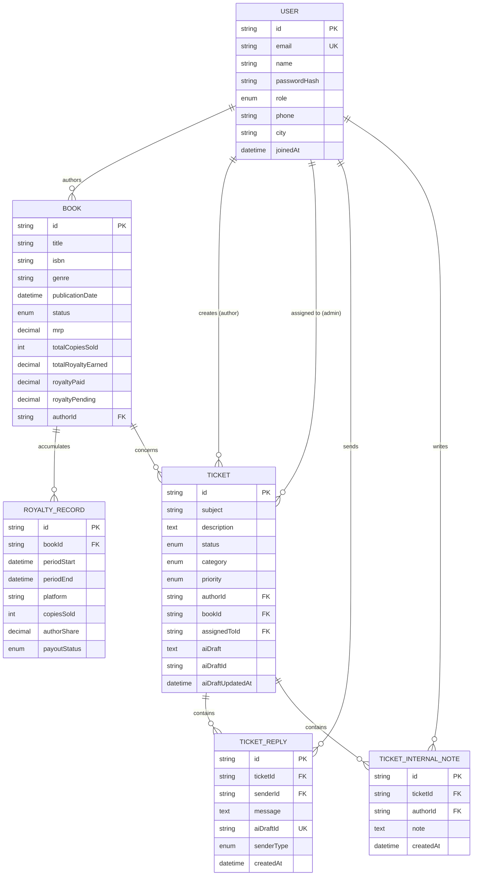

# Database Design & Schema: BookLeaf AuthorDesk

BookLeaf AuthorDesk uses MySQL 8.0+ managed through Prisma ORM. This document details the data models, relations, enums, and indexing strategies.

---

## 1. Entity-Relationship Overview

---

## 2. Enums

- **`UserRole`:** `AUTHOR`, `ADMIN`
- **`BookStatus`:** `MANUSCRIPT_RECEIVED`, `EDITING`, `COVER_DESIGN`, `TYPESETTING`, `PROOFREADING`, `ISBN_ASSIGNMENT`, `PRINTING`, `DISTRIBUTION_SETUP`, `PUBLISHED_LIVE`, `CANCELLED`
- **`RoyaltyPayoutStatus`:** `PENDING`, `PARTIALLY_PAID`, `PAID`
- **`TicketStatus`:** `OPEN`, `IN_PROGRESS`, `RESOLVED`, `CLOSED`
- **`TicketCategory`:** `ROYALTY_PAYMENTS`, `ISBN_METADATA_ISSUES`, `PRINTING_QUALITY`, `DISTRIBUTION_AVAILABILITY`, `BOOK_STATUS_PRODUCTION`, `GENERAL_INQUIRY`
- **`TicketPriority`:** `CRITICAL`, `HIGH`, `MEDIUM`, `LOW`
- **`ReplySenderType`:** `AUTHOR`, `ADMIN`

---

## 3. Key Indexing Strategies

- **Admin Ticket Queue Filtering:**
  - `Ticket @@index([status, priority, createdAt])`: Optimizes multi-column filtering by ticket status and priority with chronological sorting.
- **Author Ticket Timeline:**
  - `Ticket @@index([authorId, status])`: Optimizes author overview and ticket listing queries.
- **Conversation Threading:**
  - `TicketReply @@index([ticketId, createdAt])`: Guarantees fast, chronological reply retrieval.
  - `TicketReply.aiDraftId @unique`: Ensures database-level uniqueness to prevent duplicate AI draft submissions.
- **Internal Notes:**
  - `TicketInternalNote @@index([ticketId, createdAt])`: Optimizes administrative note retrieval.
